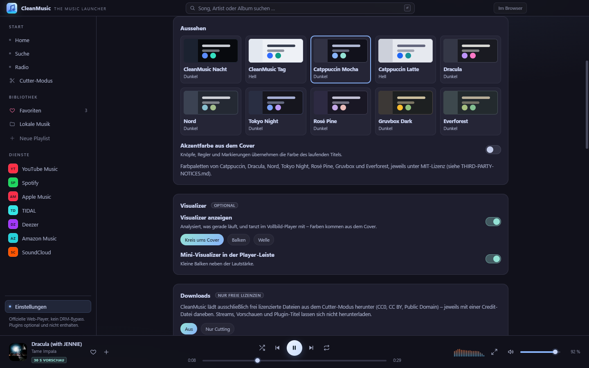

<p align="center"></p>

# CleanMusic – The Music Launcher

> Inoffizielles Projekt. Nicht verbunden mit Spotify, Apple, Google/YouTube,
> Amazon, TIDAL, Deezer oder SoundCloud.

**Version 1.3.0**

Ein Startpunkt für alle großen Musik-Streaming-Dienste. Jeder Dienst läuft in
seinem **eigenen offiziellen Web-Player** in einem eingebetteten Browser-Fenster
mit gespeichertem Login. Lokale Musik, Radio und **30-Sekunden-Vorschauen**
spielt CleanMusic **selbst** ab – dazu kommen **Favoriten, Playlists und
Vorschläge** über alle Quellen hinweg, ein **Cutter-Modus** mit Musik und
Soundeffekten für Videos, ein **Vollbild-Player mit Visualizer** und optional
**Discord Rich Presence**.

Optional lassen sich **Quellen-Plugins** einbinden: einzelne Dateien, die du
selbst in den Plugin-Ordner legst und bewusst aktivierst. Es werden **keine
Plugins mitgeliefert**.

Kein DRM-Bypass. Kein Herunterladen oder Speichern von Streams.

## Einblicke

<p align="center">
  
</p>

<table>
  <tr><th colspan="2">Zehn Themes und Akzentfarbe aus dem Cover</th></tr>
  <tr><td colspan="2"></td></tr>
  <tr><th>Cutter-Modus</th><th>Vollbild-Player mit Visualizer</th></tr>
  <tr>
    <td></td>
    <td></td>
  </tr>
</table>

---

## Download

Unter [Releases](https://github.com/BellocccYT/cleanmusic/releases/latest):

| Datei | Für wen |
| --- | --- |
| `CleanMusic-<version>-setup.exe` | **Installer** – Startmenü- und Desktop-Verknüpfung, Deinstallation über die Windows-Einstellungen, Updates mit einem Klick |
| `CleanMusic-<version>-portable.exe` | **Portable** – keine Installation, einfach doppelklicken (z. B. vom USB-Stick) |
| `CleanMusic-<version>.AppImage` | Linux |

Installer und portable EXE teilen sich dasselbe Profil (`%APPDATA%\CleanMusic`):
Favoriten, Playlists und Einstellungen sind in beiden da. Beim Deinstallieren
bleibt das Profil erhalten.

**Tipp für Streamer (Elgato Wave Link, Windows-App-Lautstärke):** Nimm den
Installer. Die portable EXE entpackt sich bei jedem Start in einen neuen
Temp-Ordner – für Wave Link und Windows ist sie dann jedes Mal ein „neues“
Programm, und die Zuordnung zu einem Kanal oder Ausgabegerät geht verloren.
Die installierte Version liegt immer am selben Ort.

Die Dateien sind nicht code-signiert – Windows
SmartScreen fragt beim ersten Start einmal nach (*Weitere Informationen →
Trotzdem ausführen*).

## Erste Schritte

Beim allerersten Start führt ein kurzer **Assistent** durch CleanMusic: Theme wählen,
Musikordner hinzufügen, was CleanMusic alles abspielt, die wichtigsten Optionen
(Autoplay, Update-Suche, Downloads, Visualizer, Infobereich) und Plugins. Jederzeit
erneut unter *Einstellungen → System → „Erste Schritte erneut zeigen“*. Nach einem
Update zeigt eine kleine Karte, was neu ist.

## Was zu 100 % in CleanMusic läuft

| Bereich | Status |
| --- | --- |
| Lokale Dateien (MP3, FLAC, WAV, M4A, AAC, OGG, OPUS, WMA, AIFF) | ✅ eigener Player, eigene Bibliothek |
| **Song-Suche mit In-App-Wiedergabe** | ✅ Apple Music + Deezer Katalog, 30-s-Vorschauen direkt im Player |
| **Beliebte Titel** | ✅ Deezer-Charts, sofort abspielbar |
| **Live-Radio** | ✅ tausende öffentliche Sender, volle Songs, kein Login, kein DRM |
| **Favoriten & Playlists** | ✅ ♥ und + an jedem Titel/Sender, gemischt aus allen Quellen, Drag & Drop |
| **Vorschläge „Für dich“** | ✅ aus deinen Favoriten (Deezer-Artist-Radio, verwandte Artists, optional über Plugins) |
| **Cutter-Modus** | ✅ NCS, YouTube-Klassiker (CC BY), Soundeffekte & freie Musik mit Lizenz und Credit |
| **Vollbild-Player & Visualizer** | ✅ Cover-Farben, Beat-Puls, Kreis/Balken/Welle, Kino-Modus |
| **Discord Rich Presence** | ⚙️ optional – eigene Discord-Application-ID nötig |
| **Quellen-Plugins** | ⚙️ optional – nicht enthalten, Datei in den Plugin-Ordner legen und aktivieren |
| Apple Music | ✅ offizieller Web-Player; zusätzlich **MusicKit-Fenster** für volle Titel (Developer-Token nötig) |
| Spotify, YouTube Music, TIDAL, Deezer, Amazon Music, SoundCloud | ✅ als offizieller Web-Player eingebettet |
| Suche in einem Dienst | ✅ startet die Suche im jeweiligen Web-Player |

### Songs & Vorschauen

Die **Suche** zeigt Treffer aus dem Apple-Music- und Deezer-Katalog direkt in
CleanMusic: Cover, Artist, Album, Quelle und ein Play-Button. Beim Start der
Suche erscheinen zusätzlich die aktuellen Deezer-Charts.

- **Vorschauen (30 s)** laufen komplett in der App – über die offiziellen
  Preview-URLs von Apple (iTunes Search API) und Deezer. Kein Login nötig.
- **Volle Titel** laufen dort, wo es geht: lokale Dateien, Apple Music über
  das **MusicKit-Fenster** (Developer-Token + Abo) oder über ein aktives
  **Quellen-Plugin**.
- Der Button **↗** öffnet den Titel im jeweiligen Dienst (Web-Player oder
  System-Browser).
- Der **Globus-Button** pro Titel öffnet ein Menü: „In Spotify / YouTube Music /
  Amazon Music … suchen". So springst du mit einem Klick vom 30-s-Treffer in
  den vollen Song im Dienst.

### Favoriten, Playlists & Vorschläge

- **♥** an jedem Titel, jeder Vorschau, jedem Plugin-Treffer, jeder lokalen
  Datei und jedem Radiosender – oder im Player unten links für den laufenden
  Titel. Alles landet unter **Bibliothek → Favoriten** (Filter: Titel / Radio).
- **+** fügt einen Titel einer **Playlist** hinzu oder legt direkt eine neue
  an. Playlists mischen alle Quellen, zeigen ein Cover-Mosaik und lassen sich
  umbenennen, löschen, abspielen und shuffeln.
- **Drag & Drop:** Titel aus jeder Liste auf *Favoriten*, eine Playlist oder
  *Neue Playlist* in der Seitenleiste ziehen. In einer Playlist per Griff
  sortieren.
- **„Neu für dich“** auf der Startseite und **„Mehr wie deine Favoriten“** in den
  Favoriten: CleanMusic nimmt deine häufigsten Favoriten-Artists **und was du
  zuletzt oft gehört hast** und holt über die öffentliche Deezer-API Artist-Radio
  und Top-Titel verwandter Artists. Gerade Gehörtes wird nicht erneut vorgeschlagen.
  Ein aktives Quellen-Plugin steuert verwandte Titel zu deinen Plugin-Favoriten bei.
  **Neu mischen** lädt frische Vorschläge.
- **Trending & Neuheiten:** Deezer-Charts oder neue Alben der Deezer-Redaktion
  (umschaltbar). **Wiederentdecken:** Titel, die du oft gehört oder favorisiert,
  aber lange nicht mehr gespielt hast.
- **Hör-Verlauf:** Ein Titel zählt nach 20 Sekunden (Vorschau: 12 s) als gehört.
  Der Verlauf (max. 300 Titel) bleibt lokal; Radio wird nicht erfasst.
- Abgelaufene Deezer-Vorschau-Links in Favoriten/Playlists werden beim
  Abspielen automatisch erneuert.

Alles bleibt lokal (im Profil der App); es gibt kein Konto und keine Cloud.

### Playlists übertragen

Unter **Bibliothek → Playlist übertragen** kannst du Spotify-Playlists per öffentlichem
`open.spotify.com/playlist/...`-Link oder Spotify-URI sowie YouTube-/YouTube-Music-Playlists
per Link übertragen (`music.youtube.com/playlist?list=…`, `youtube.com/playlist?list=…`
oder ein Video mit `&list=…`). Für YouTube Music brauchst du ein aktives Quellen-Plugin
mit Playlist-Import (ab Version 1.2.0). Ohne Plugin kannst du die Playlist auf
[TuneMyMusic](https://www.tunemymusic.com/) als CSV exportieren und in CleanMusic laden.

Für private Spotify-Playlists kannst du bei exportify.app mit deinem Spotify-Konto eine
CSV-Datei exportieren. Auch CSV-Dateien von TuneMyMusic und Soundiiz sowie Spotifys
Playlist-JSON aus dem persönlichen Datenexport werden unterstützt. Bei JSON-Exporten
mit mehreren Playlists kannst du auswählen, welche du übertragen möchtest.

Spotify-Playlists werden wie bisher mit öffentlichen Deezer-Vorschauen abgeglichen;
nicht gefundene Titel zeigt CleanMusic am Ende an. YouTube-Playlists werden direkt als
volle Titel des aktiven Plugins übernommen. Spotify kann über den öffentlichen Link nur
bis zu 100 Titel anzeigen; für vollständige Playlists bitte den Datei-Import verwenden.

### Cutter-Modus (für Videos)

Musik und Soundeffekte, die du in Videos verwenden darfst – mit Lizenz an jedem
Titel und fertigem Credit:

| Bereich | Quelle | Lizenz | Wiedergabe |
| --- | --- | --- | --- |
| **NCS** – 21 Kategorien (Top 100, Trending auf YouTube, Gaming, Phonk, House, Drum & Bass, Dubstep, Trap …) | offizielle NCS-Playlists bei Deezer | NCS: frei für YouTube/Twitch/Social mit Credit | 30-s-Vorschau (Apple-Katalog), mit Quellen-Plugin voller Titel |
| **YouTube-Klassiker** – Kevin MacLeod in 6 Stimmungen plus **Gaming & Retro** (*Itty Bitty 8 Bit*, *Pixel Peeker Polka*, *Hyperfun* …) | incompetech.com | CC BY 4.0 | volle Titel |
| **Soundeffekte** – Whoosh, Transition, Impact, Riser, Pop, Klick, Glitch, Applaus, Lachen, Fail … oder eigene Suche | Freesound über Openverse | CC0 oder CC BY (pro Sound angezeigt) | volle Sounds |
| **Game-Sounds** – Retro & 8-Bit, Münze & Power-up, Sprung, Level-Up & Sieg, Game Over, Menü & UI, Arcade, RPG & Fantasy, Horror-Game, Sci-Fi-Waffen, Racing | Freesound über Openverse | CC0 oder CC BY (pro Sound angezeigt) | volle Sounds |
| **Freie Musik** – Cinematic, Upbeat, Episch, Entspannt, Chiptune/8-Bit, Videospiel, Boss-Kampf … oder eigene Suche | Jamendo & Co. über Openverse | CC0 oder CC BY | volle Titel |

- **Kopier-Knopf** an jedem Titel: kopiert den Credit in die Zwischenablage und
  sammelt ihn in **Video-Credits**. *Alle kopieren* liefert den kompletten Block
  für die Videobeschreibung.
- Lizenz-Badge (CC0 · CC BY · NCS) und ↗ zur Quelle bzw. zum Download beim Urheber.
- Openverse erlaubt ohne Konto ~200 Anfragen am Tag; CleanMusic speichert
  Ergebnisse deshalb 24 h zwischen.

### Epidemic Sound & Artlist (mit deinem Abo)

Unter **Creator** in der Seitenleiste und als Knöpfe im **Cutter-Modus** laufen die
offiziellen Web-Apps von **Epidemic Sound** und **Artlist** eingebettet – Login bleibt
gespeichert. Was du dort über deren Download-Knöpfe mit deinem Abo herunterlädst,
speichert CleanMusic ohne Rückfrage in `Musik\CleanMusic Cutting\Epidemic Sound\`
bzw. `…\Artlist\`, mit einer `– Lizenz.txt`-Notiz daneben. Im Cutter-Modus stehen
die letzten Abo-Downloads unter den Video-Credits – zum Ziehen ins Schnittprogramm.
Gespeichert werden nur Audiodateien (und ZIP mit Stems). CleanMusic greift nicht an
den Web-Apps vorbei auf Dateien zu.

### Downloads: nur freie Dateien für Videos

Unter *Einstellungen → Downloads* gibt es genau zwei Stufen: **Aus** (Standard)
und **Nur Cutting**. Dann bekommen frei lizenzierte Titel im Cutter-Modus
(**CC0, CC BY, Public Domain** – Kevin MacLeod, Freesound, Jamendo über
Openverse) einen Download-Knopf. Jede Datei landet in
`MusikCleanMusic Cutting<Kategorie>\x60 (Ordner änderbar), daneben eine
`.txt` mit Lizenz und fertigem Credit-Text. Fertige Downloads ziehst du über das
grüne Datei-Symbol direkt in dein Schnittprogramm; ein Klick zeigt die Datei im
Explorer. Streams, Vorschauen, NCS-Titel und Plugin-Titel lassen sich
**nicht** herunterladen – einen Modus „alles herunterladen“ gibt es bewusst nicht.

### Vollbild-Player

Taste **F**, der Knopf ⤢ in der Player-Leiste oder Doppelklick aufs Cover:

- großes Cover, das im Takt pulsiert; Hintergrund und Leuchten in den Farben
  des Covers
- Visualizer im Stil *Kreis ums Cover*, *Balken* oder *Welle* (oben rechts umschaltbar)
- „Als Nächstes“ mit den kommenden Titeln (anklickbar)
- Kino-Modus: nach ein paar Sekunden ohne Mausbewegung verschwinden Bedienelemente und Zeiger
- Tasten: **Leertaste** Play/Pause · **← →** ±5 s · **↑ ↓** Lautstärke ·
  **N / P** weiter/zurück · **Esc** schließen

### Themes

Zehn Farbschemata unter *Einstellungen → Aussehen*: **CleanMusic Nacht** (Standard),
**CleanMusic Tag** (hell), **Catppuccin Mocha / Latte**, **Dracula**, **Nord**,
**Tokyo Night**, **Rosé Pine**, **Gruvbox Dark** und **Everforest**. Die Paletten
der Community-Themes stehen unter MIT-Lizenz (siehe
[THIRD-PARTY-NOTICES.md](THIRD-PARTY-NOTICES.md)). Optional übernimmt die
**Akzentfarbe das Cover** des laufenden Titels – automatisch so angepasst, dass
sie auf hellen und dunklen Themes lesbar bleibt.

### Lautstärke

- Der Regler arbeitet **gehörrichtig** (feine Schritte im leisen Bereich), mit
  Prozentanzeige und Lautsprecher-Symbol in Stufen.
- **Mausrad** auf Regler oder Lautsprecher (mit Umschalt in 1-%-Schritten),
  **M** schaltet stumm, **+ / −** regeln überall, **↑ / ↓** im Vollbild-Player.
- Optional unter *Einstellungen → Wiedergabe*: **Lautstärke angleichen** (sanfter
  Kompressor gleicht laute und leise Titel an) und **Boost bis 150 %** mit
  Limiter gegen Übersteuern. Beides ist standardmäßig aus.
- **Klang:** Bass und Höhen (Regler und Voreinstellungen wie *Mehr Bass*, *Stimme klar*,
  *Laptop-Lautsprecher*) unter *Einstellungen → Wiedergabe*. 0 dB = unverändert.

### Visualizer (optional)

Analysiert über die Web-Audio-API, was gerade läuft – lokale Dateien, Vorschauen,
Radio, Plugin-Titel. Die Wiedergabe selbst wird dabei nicht umgeleitet (Analyse
per `captureStream()`), es kann also nichts stumm werden. Ist *Lautstärke
angleichen* oder *Boost* an, läuft der Ton ohnehin über Web Audio; der
Visualizer hört dann direkt dort mit. Ein- und ausschalten,
Stil wählen und den **Mini-Visualizer** in der Player-Leiste gibt es unter
*Einstellungen → Visualizer*. Bei Pause zeichnet er nur noch ~8× pro Sekunde.
Die Spektrum-Balken funktionieren auch, wenn der Ton über die optionale
Lautstärke-/Klang-Kette läuft.

### Discord Rich Presence (optional)

Zeigt in deinem Discord-Profil „Hört CleanMusic“ mit Titel, Artist, Cover,
Fortschrittsbalken und einem *Anhören*-Link. Läuft lokal über den
Discord-Client (IPC), standardmäßig **aus**.

1. Im [Discord Developer Portal](https://discord.com/developers/applications)
   „New Application“ anlegen, Name z. B. *CleanMusic*.
2. Die **Application ID** unter *Einstellungen → Discord Rich Presence*
   eintragen, *Speichern*, Schalter an.
3. Optional ein Bild namens `logo` unter *Rich Presence → Art Assets*
   hochladen (wird gezeigt, wenn ein Titel kein Cover hat oder „Cover
   anzeigen“ aus ist).

### Live-Radio

Unter **Radio** findest du tausende öffentliche Sender über die
[Radio-Browser-API](https://www.radio-browser.info/):

- Genre-Filter (Pop, Rock, Electronic, Jazz, Techno, Schlager, 80s, 90s …)
- Sendersuche
- **Volle Songs, kein Login, kein DRM** – die Sender streamen öffentlich
- LIVE-Anzeige statt Fortschrittsbalken
- läuft im selben Player wie lokale Titel und Vorschauen

### Warteschlange & Autoplay

- **„Als Nächstes abspielen“** und **„Zur Warteschlange hinzufügen“** über das
  +-Menü oder per **Rechtsklick** auf jeden Titel. Eingereihte Titel kommen immer
  zuerst – auch bei Zufallswiedergabe und wenn du eine andere Liste startest.
- **Warteschlange** (Listen-Symbol in der Player-Leiste): läuft gerade, von dir
  eingereiht, Rest der Liste, Autoplay. Ziehen zum Sortieren, ✕ zum Entfernen,
  Klick zum Abspielen.
- **Autoplay** (Standard an): Ein Titel aus der Suche spielt allein, danach laufen
  passende Vorschläge weiter (Artist-Radio, bei Plugin-Titeln deren verwandte Titel).
  Auch am Ende einer Liste geht es so weiter. Nicht bei Radio, lokalen Dateien
  und Cutter-Sounds. Abschaltbar in der Warteschlange oder unter *Einstellungen → Wiedergabe*.

### Player

- Shuffle und Repeat (aus / alle / Titel) mit gespeichertem Zustand
- Queue aus lokalen Titeln, Vorschauen, Plugin-Titeln, Radiosendern, Favoriten
  oder Playlists
- Cover, Artist und Quellen-Badge im „Now Playing" (z. B. *30 s Vorschau*,
  *Voll · Quelle des Plugins*, *Radio · LIVE*)
- ♥ und + für den laufenden Titel direkt im Player

---

## Updates

CleanMusic sucht **bei jedem Start** nach einer neuen Version (abschaltbar unter
*Einstellungen → Updates*, dort gibt es auch **Jetzt suchen**). Ist eine da,
erscheint unten rechts ein Hinweis:

- **Installiert (Setup):** *Updaten* lädt den neuen Installer, prüft Größe und
  SHA-256-Prüfsumme; nach *Jetzt installieren* schließt sich CleanMusic kurz,
  installiert das Update ohne Rückfragen und startet von selbst neu.
- **Portable EXE und AppImage** aktualisieren sich selbst: *Updaten* lädt
  die neue Datei neben deine jetzige, prüft Größe und SHA-256-Prüfsumme und
  startet sie nach *Jetzt neu starten*. Die alte EXE kannst du danach löschen.
- Deine Daten bleiben in jedem Fall, weil sie im App-Profil liegen.
- Aus dem Quellcode gestartet gibt es einen Link zur Download-Seite.

Gefragt wird nur die öffentliche Release-Liste dieses Repositorys auf GitHub,
ohne persönliche Daten.

---

## Plugins (optional)

CleanMusic kann **Quellen-Plugins** laden – einzelne `.js`-Dateien, die weitere
Quellen für Suche, volle Titel und Vorschläge anbinden. **Es werden keine
Plugins mitgeliefert.**

1. Wähle in *Einstellungen → Plugins* **Plugin-Datei hinzufügen …** und öffne
   eine `.js`-Datei. Du kannst sie auch per Drag & Drop auf den Plugin-Bereich
   ziehen. CleanMusic kopiert die Datei in deinen Plugin-Ordner im App-Profil
   (z. B. `%APPDATA%\CleanMusic\plugins`).
2. Die Plugin-Liste wird automatisch neu eingelesen. Das Plugin bleibt
   **ausgeschaltet**. Erst beim Aktivieren wird es geladen – nach einer
   Rückfrage, denn Plugins laufen mit vollen Rechten.
3. Liegt im Profil schon eine Datei mit demselben Namen, fragt CleanMusic vor
   dem Überschreiben. Nach dem Ersetzen bleibt das Plugin ausgeschaltet.

Ein aktives Plugin kann:

- **Suchen:** eigener Trefferblock in der Suche.
- **Volle Titel abspielen:** CleanMusic streamt die URL, die das Plugin liefert.
- **Abgleichen:** Apple-Music-/Deezer-Vorschauen als vollen Titel abspielen
  (eigener Schalter, sonst läuft die 30-s-Vorschau).
- **Vorschläge:** verwandte Titel zu deinen Favoriten aus dieser Quelle.

Was ein Plugin tut und ob das bei der jeweiligen Quelle erlaubt ist, liegt in
der Verantwortung von dir bzw. der Person, die das Plugin geschrieben hat.
Die Schnittstelle ist in [docs/PLUGIN-API.md](docs/PLUGIN-API.md) beschrieben.
Ein Plugin mit `charts()` bekommt auf der Startseite unter *Trending & Neuheiten*
einen eigenen Reiter (z. B. Top-Listen seiner Quelle).
Seit **API v2** können Plugins auf Titelwechsel reagieren, den Player steuern
und eigene Einstellungsfelder in ihrer Plugin-Karte anzeigen; v1-Plugins laufen
unverändert. Siehe auch die Hinweise zu Plugins in [LEGAL.md](LEGAL.md).

### Streamer.bot (optionales Plugin)

[`extras/plugins/streamerbot.js`](extras/plugins/) bringt Twitch-Chat-Befehle über
Streamer.bot: `!song` postet den aktuellen Titel, `!skip` und `!pause` steuern
CleanMusic (Token-geschützt, nur lokal). Optional **Songwünsche** mit `!sr`,
`!wrongsong` und `!wishes` – mit Limits pro Zuschauer, in der Warteschlange als
„Wunsch von …“ markiert. Anleitung:
[extras/plugins/README.md](extras/plugins/README.md#streamerbot-streamerbotjs).

### OBS Now-Playing (optionales Plugin)

Im Repository liegt unter [`extras/plugins/obs-overlay.js`](extras/plugins/)
ein fertiges Plugin für Streamer: Es zeigt den laufenden Titel als
**transparentes Overlay in OBS** (Browserquelle, Stil *Karte mit Cover*,
*Schmale Leiste* oder *Nur Text*, live aktualisiert) und schreibt auf Wunsch
`nowplaying.txt`, `title.txt`, `artist.txt` und `cover.jpg`. Der kleine
Server läuft nur auf `127.0.0.1`. Es ist **nicht** in der EXE enthalten –
hinzufügen wie jedes andere Plugin, Anleitung in
[extras/plugins/README.md](extras/plugins/README.md).

---

## Was es bewusst **nicht** macht

- DRM-Streams entschlüsseln oder Streams speichern / herunterladen (Downloads
  gibt es nur für frei lizenzierte Dateien aus dem Cutter-Modus)
- Plugins oder Downloader mitliefern
- Werbung blockieren
- Einen „einen Player für alle" vortäuschen: Spotify, TIDAL, Amazon & Co.
  bleiben in ihren offiziellen Web-Playern

Ein Musik-Launcher funktioniert wie Heroic nur in einer Hinsicht: Er **startet**
den richtigen Player. Er ersetzt ihn nicht, weil Musik – anders als DRM-freie
Spiele-Binaries – serverseitig verschlüsselt gestreamt wird.

---

## Starten

```powershell
npm.cmd install
npm.cmd start
```

Falls PowerShell Skripte blockiert (`npm.ps1 cannot be loaded`), immer
`npm.cmd` statt `npm` verwenden.

Falls Electron nach der Installation nicht startet ("Electron failed to install
correctly"), den Binary-Download einmal manuell nachholen:

```powershell
node node_modules/electron/install.js
```

Entwicklung mit DevTools:

```powershell
npm.cmd run dev
```

Smoke-Test (Fenster bleibt unsichtbar, eigenes Wegwerf-Profil – deine
Favoriten werden nicht angefasst): prüft Renderer, Vorschauen, Radio,
Favoriten, Playlists und Vorschläge.

```powershell
npm.cmd run smoke
```

Zusätzlich das erste gefundene Plugin aktivieren und durchspielen (Suche,
voller Titel, Abgleich, Vorschläge – dauert je nach Plugin ~1 Minute):

```powershell
npm.cmd run smoke:plugin
```

Im Entwicklungsmodus (`npm.cmd start`) wird zusätzlich der Projektordner
`plugins` durchsucht; in der fertigen EXE nur der Plugin-Ordner des Profils
und `plugins` neben der portablen EXE.

## Fertige EXE bauen

```powershell
npm.cmd run build:win
```

Ergebnis:

- `release\CleanMusic-1.1.0-setup.exe` – **Installer** (ein Klick, pro Benutzer,
  ohne Admin-Rechte; installiert nach `%LOCALAPPDATA%\Programs\cleanmusic`)
- `release\CleanMusic-1.1.0-portable.exe` – **eine einzelne portable EXE**,
  kein Installer, einfach doppelklicken
- `release\win-unpacked\CleanMusic.exe` – entpackte Variante, startet etwas
  schneller (Ordner muss zusammenbleiben)

`release/` bleibt aus Git ausgeschlossen. Für eine Weitergabe hängst du die
EXE-Dateien als Assets an ein GitHub Release (macht der Workflow bei einem
`v*`-Tag), statt sie ins Repository zu committen.

Die EXE ist nicht code-signiert. Windows SmartScreen zeigt beim ersten Start
„Windows hat den PC geschützt" → **Weitere Informationen** →
**Trotzdem ausführen**. Für eine signierte Version braucht es ein
Code-Signing-Zertifikat.

## Linux / AppImage

AppImages müssen auf Linux gebaut werden – electron-builder kann sie nicht
unter Windows cross-kompilieren.

```bash
npm run build:linux
```

Ergebnis: `release/CleanMusic-1.1.0.AppImage`.

Alternativ über GitHub Actions: Das Workflow-File
`.github/workflows/build.yml` baut bei jedem `v*`-Tag automatisch die
Windows-Portable-EXE **und** das Linux-AppImage und hängt beides an das
GitHub-Release.

**Widevine unter Linux:** Ohne installiertes Chrome/Chromium mit
`libwidevinecdm.so` funktionieren Spotify, Apple Music, Deezer und Amazon
Music im AppImage nicht. CleanMusic sucht beim Start nach dem CDM; wenn keiner
da ist, bleibt der „Im Browser öffnen"-Fallback. Details:
[LEGAL.md](LEGAL.md).

---

## Bedienung

- **Sidebar** → Dienst anklicken: der offizielle Web-Player öffnet sich eingebettet.
- **Bibliothek** → Favoriten, lokale Musik, deine Playlists, *Neue Playlist*.
- **Suche oben** → Enter: Treffer mit Vorschau (und mit aktivem Plugin dessen Treffer).
- **♥ / +** an jedem Titel, auch im Player unten links.
- **Drag & Drop** von Titeln auf Favoriten oder Playlists in der Seitenleiste.
- **Lokale Musik** → Ordner hinzufügen, Titel anklicken, unten abspielen.
- **Einstellungen** → Plugins, System-Browser, Sessions zurücksetzen,
  MusicKit-Fenster.
- **Cutter-Modus** → Kategorien durchklicken, Kopier-Knopf sammelt Credits.
- **F** öffnet den Vollbild-Player (Leertaste, Pfeiltasten, N/P, Esc).
- **M** stumm, **+ / −** lauter/leiser, **Mausrad** auf dem Lautstärkeregler.
- **Infobereich (Tray):** Symbol mit aktuellem Titel, Play/Pause, Weiter, Zurück.
  Optional läuft CleanMusic beim Schließen dort weiter (*Einstellungen → Wiedergabe*).
- **Schlaf-Timer** (Mond-Symbol in der Player-Leiste): Stopp nach 15–90 Minuten
  oder am Ende des Titels.
- **Video-Credits** im Cutter-Modus kopieren oder **als .txt speichern**.
- **Medientasten** der Tastatur und das **Windows-Medien-Overlay** (mit Titel,
  Artist und Cover) steuern CleanMusic.
- **Einstellungen → Sichern & Wiederherstellen** → Favoriten, Playlists,
  Video-Credits, Verlauf und Aussehen als JSON sichern oder auf einem anderen PC
  ergänzen (es wird nichts gelöscht).
- **Einstellungen → Aussehen** → Theme wählen, Akzentfarbe aus dem Cover.
- **Strg + K** fokussiert die Suche.
- **?** (oder **F1**) zeigt alle Tastenkürzel – auch unter *Einstellungen → System*.

Jeder Dienst bekommt eine eigene persistente Session (`persist:cm-<dienst>`),
Logins bleiben also nach einem Neustart erhalten. Über *Einstellungen →
Dienst-Daten → zurücksetzen* meldest du einen Dienst wieder ab.

---

## Technische Hinweise

### Woher die Songs kommen

Die Suche, die Charts und die Vorschläge werden im Hauptprozess über
offizielle, öffentliche Schnittstellen geladen:

- **Apple Music:** `itunes.apple.com/search` (iTunes Search API) – liefert
  Titelmetadaten und eine offizielle `previewUrl` (30 s, AAC).
- **Deezer:** `api.deezer.com/search`, `/chart`, `/artist/{id}/radio`,
  `/artist/{id}/related`, `/artist/{id}/top`, `/playlist/{id}/tracks` –
  Metadaten und offizielle `preview`-URLs (30 s, MP3). NCS-Titel haben bei
  Deezer oft keine Vorschau; CleanMusic holt sie dann beim Abspielen über die
  iTunes-Suche (gleicher Artist und Titel) samt Cover.
- **incompetech.com:** die Kevin-MacLeod-MP3s, wie vom Urheber bereitgestellt.
- **Openverse** (`api.openverse.org`): Creative-Commons-Suche für Freesound-
  und Jamendo-Audio, gefiltert auf CC0 und CC BY, inklusive Attribution.

Die Vorschau-URLs sind ausdrücklich für die Einbindung gedacht. CleanMusic
lädt sie in den eigenen `<audio>`-Player, speichert keine Streams und
entschlüsselt nichts.

### Widevine / DRM

Electron bringt kein Widevine mit. CleanMusic sucht beim Start das neueste
Widevine-CDM von Chrome oder Edge unter Windows und lädt es über
`--widevine-cdm-path` (Verzeichnis mit `widevinecdm.dll`). Das ist **kein**
Umgehen von DRM: Der CDM holt sich weiterhin eine gültige Lizenz vom Dienst.
Ohne CDM zeigen Spotify, Apple Music, Deezer und Amazon Music nur Fehler –
YouTube Music und SoundCloud laufen meist trotzdem.

Der Status steht in *Einstellungen → System*.

**Wichtige Einschränkung (VMP):** Chrome ab Version 59 verlangt für die
Lizenzvergabe ein „Verified Media Path"-signiertes Binary. Stock-Electron ist
nicht VMP-signiert. Viele Dienste liefern trotzdem Lizenzen, manche (z. B.
bestimmte Spotify-/Amazon-Titel) verweigern sie mit einem Lizenzfehler. Dann
hilft nur der System-Browser oder der lizenzierte
[castLabs-Electron-Fork](https://github.com/castlabs/electron-releases).
CleanMusic zeigt in dem Fall den Banner **Im Browser öffnen**.

### User-Agent

Die App meldet sich als normales Chrome, sonst verweigern einige Player den
Start. Google-Logins können trotzdem gelegentlich als „unsicherer Browser"
abgelehnt werden – dann hilft nur der Login im System-Browser. Der Button
**Im Browser** ist überall vorhanden.

### Speicher

Jeder eingebettete Player ist ein eigener Chromium-Renderer. Wenn du alle sieben
Dienste gleichzeitig öffnest, braucht das entsprechend RAM. CleanMusic erstellt
einen Player erst beim ersten Öffnen und behält ihn dann im Hintergrund, damit
die Musik weiterläuft.

### Daten

Favoriten, Playlists, Video-Credits, Bibliothek, Vorschläge und Einstellungen liegen im
`localStorage` des App-Profils. Welche Plugins aktiv sind, deren eigene
Einstellungen und die Discord-Einstellungen liegen in `cleanmusic-config.json` im selben Profil – das darf
nur der Hauptprozess schreiben.

### Apple MusicKit

`Einstellungen → Apple Music → MusicKit-Fenster öffnen`. Dort trägst du einen
MusicKit-Developer-Token (ES256-JWT aus deinem Apple-Developer-Account) ein.
Damit läuft echte In-App-Wiedergabe über Apples Player-SDK. Der Token bleibt
lokal in `localStorage` des MusicKit-Fensters.

---

## Rechtliches

Die eingebetteten Player sind die offiziellen Web-Angebote der Anbieter; es
gelten deren Nutzungsbedingungen. Für eine **Veröffentlichung** einer solchen
App brauchst du bei den meisten Diensten eine Freigabe (Spotify, Apple, TIDAL
haben eigene Partner-/Review-Prozesse). Für den privaten Gebrauch ist das
Einbetten der offiziellen Player der pragmatische, aber nicht garantierte Weg.

CleanMusic selbst umgeht keine technischen Schutzmaßnahmen und verbreitet
keine Audiodateien. **Plugins sind nicht Teil von CleanMusic:** Sie werden
nicht mitgeliefert, sind standardmäßig aus und laufen auf Verantwortung der
Nutzer:innen. Ein Plugin kann eine Quelle auf eine Weise nutzen, die deren
Bedingungen nicht erlauben.

Die vollständige Einordnung inklusive GitHub-/AppImage-Risiken steht in
[LEGAL.md](LEGAL.md).

---

## Struktur

```
AGENTS.md               Kontext und Regeln für künftige Code-Sitzungen
main.js                 Electron-Hauptprozess, Fenster, IPC, Widevine, Dateiscan,
                        Katalog/Charts/Radio, Vorschläge, Cutter-Quellen, Plugin-Lader,
                        Discord-Steuerung, Smoke-Test
discord-rpc.js          Discord Rich Presence über den lokalen Discord-IPC
preload.js              schmale, sichere Bridge für den Renderer
renderer/
  index.html            App-Shell
  styles.css            Layout und Farben (über Theme-Variablen)
  themes.js             die zehn Farbpaletten
  assets/               Logo und Fenster-Icon
  services.js           Dienste-Registry (URLs + offizielle Such-URLs)
  creator-data.js       Cutter-Modus: Kategorien, NCS-Playlists, YouTube-Klassiker
  visualizer.js         Web-Audio-Visualizer (Kreis, Balken, Welle, Mini) und
                        optionale Audio-Kette (Angleichen, Boost, Limiter)
  app.js                Navigation, Webviews, Bibliothek, Favoriten, Playlists,
                        Vorschläge, Cutter-Modus, Vollbild-Player, Player
  musickit.html/.js     optionale Apple-MusicKit-Wiedergabe
docs/                   Plugin-API und Screenshots für die README
extras/plugins/         optionale Plugins zum Selbst-Hinzufügen (OBS-Overlay, Streamer.bot)
build/                  App-Icons (aus tools/make-icons.js)
tools/                  Hilfsskripte (Icons erzeugen)
plugins/                Lokale Plugin-Dateien – nicht Teil des Repositorys oder der Builds
THIRD-PARTY-NOTICES.md  Lizenzhinweise der Theme-Paletten
```

## Nächste sinnvolle Schritte

Der Fahrplan zu **1.0** steht in [docs/PLAN-1.0.md](docs/PLAN-1.0.md) (Warteschlange + Autoplay,
Epidemic Sound und Artlist, Erste-Schritte-Assistent, Installer – fertig). Als Nächstes:

- **1.1: Englische Oberfläche** (Deutsch/Englisch umschaltbar, README auf Englisch).

0. **Streamer.bot Phase 2:** Titelwechsel als WebSocket-Ereignis direkt in Streamer.bot
   (Phase 1 mit !song/!skip/!pause ist fertig). Plan: [docs/PLAN-STREAMERBOT.md](docs/PLAN-STREAMERBOT.md).

1. **Cloud-freier Sync** zwischen PCs über einen selbst gewählten Ordner.
3. **Cutter-Extras:** BPM-Filter, Wellenform mit Schnittmarken, Sounds per Drag & Drop in den Editor.
4. **Scrobbling** (Last.fm / ListenBrainz) für lokale Titel, Radio und volle Titel.
5. **ISRC-Matching** für Playlist-Import/Export zwischen Diensten.
6. **MusicKit-Token-Generator** (JWT aus `.p8` lokal erzeugen).
