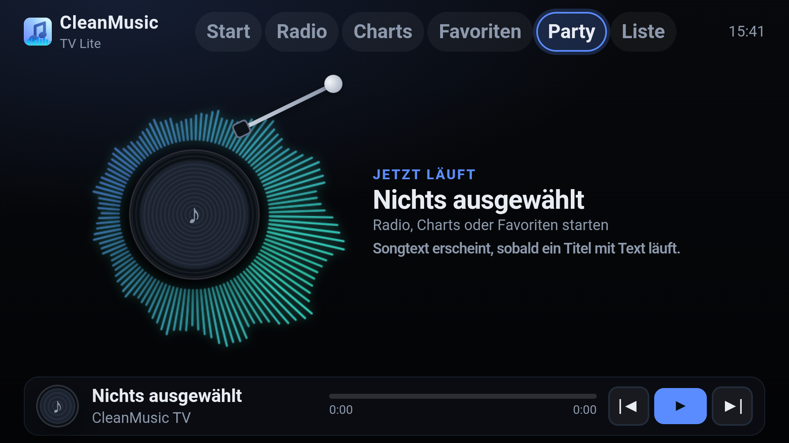

# CleanMusic für Android, Android TV, Google TV und Fire TV

Eigenes Projekt in `mobile/` (Capacitor). Läuft parallel zu den Desktop-Versionen,
mit eigenen Versionsnummern (`mobile-1.1.1`) und eigenen Release-Dateien
`CleanMusic-Android-<version>.apk`. Die Namen der Desktop-Assets bleiben
unverändert, damit der Desktop-Updater weiter funktioniert.

**Eine APK für alles.** Handy, Tablet, Android TV, Google TV und Fire TV. Die App
erkennt das Gerät (`UiModeManager`, `html[data-device="tv"]`) und startet auf dem
Fernseher automatisch **CleanMusic TV Lite**.

## Was die App kann

| Bereich | Handy / Tablet | Android TV / Google TV / Fire TV |
| --- | --- | --- |
| Vorschauen (Deezer/Apple), Radio, Charts | ✓ | ✓ |
| Favoriten, Playlists, Verlauf, Rückblick | ✓ | Favoriten, Warteschlange |
| Songtexte mit Effekten (LRCLIB) | ✓ | ✓ |
| Themes, Live-Hintergründe, Plattenspieler, Visualizer | ✓ | ✓ |
| Songs teilen | ✓ | – |
| Lokale Musik (Android-Mediathek) | ✓ | – (TV Lite lädt sie nicht) |
| Cutter-Modus | ✓ | – (gar nicht geladen) |
| Downloads, Downloads-Liste | – | – |
| Plugins, yt-dlp, Stream-Downloads | – | – |
| Handy-Steuerung per QR-Code | – | ✓ (Server im TV) |
| Eingebauter Updater | ✓ | ✓ |

Keine eingebetteten Streaming-Web-Player: „In Spotify / YouTube Music /
Apple Music öffnen“ startet per Deep Link die offizielle App. Ist sie nicht
installiert, öffnet der Browser die offizielle Webseite.

Keine Anmeldung, kein Konto, keine Telemetrie. Radio und Charts laufen direkt
nach dem Start.

## APK installieren (Handy)

1. APK von den GitHub-Releases laden (`CleanMusic-Android-<version>.apk`) oder
   über die Landingpage `…/cleanmusic/android/`.
2. Datei antippen.
3. Android fragt einmal nach „Unbekannte Apps installieren“ – für den Browser
   bzw. Dateimanager zulassen.
4. Play Protect warnt (die App ist nicht über den Play Store signiert):
   „Trotzdem installieren“.
5. Beim ersten Abspielen nach **Benachrichtigungen** gefragt werden – erlauben,
   sonst gibt es keine Steuerung auf dem Sperrbildschirm.

## TV Lite (Android TV, Google TV, Fire TV)

Dieselbe APK. Auf dem Fernseher startet eine eigene, schlanke Seite
(`www/tv.html`) – **`app.js` wird dort gar nicht geladen**. Cutter, Downloads,
Wellenform/BPM, Rückblick, Plugins, Playlist-Import, lokale Musik und die
Ansicht „Erweitert“ sind auf dem Fernseher nicht vorhanden.



Drin: Jetzt läuft (groß, mit Cover und Songtext), Radio, Charts, Favoriten,
Songtexte mit Effekten, Themes, Live-Hintergründe, Plattenspieler, Visualizer,
Warteschlange und Party-Modus. Der Party-Modus ist die große Spektrum-Bühne:
Plattenspieler mit Radial-Spektrum und Tonarm, Karaoke-Text, „Als Nächstes“ unten;
auf der Startseite dreht sich ein Spektrum-Ring ums Cover, „Spektrum groß“ öffnet
die Bühne. Die Analyse läuft über `captureStream`; gibt Android keine Tonspur
frei, animiert der Ring als Ersatz (rein visuell).

- Schrift mindestens 24 px, Ränder für Overscan (5 %), klarer Fokusrahmen.
- Fernbedienung: Pfeile + OK, Play/Pause, Weiter/Zurück, Zurück-Taste.
- Startbildschirm zeigt groß den QR-Code „Mit dem Handy scannen“.
- Im Manifest: `android.software.leanback` (required=false),
  `android.hardware.touchscreen` (required=false), `LEANBACK_LAUNCHER`,
  TV-Banner 320×180 (`res/drawable-xhdpi/tv_banner.png`).

### Handy-Steuerung

Der Fernseher startet einen kleinen HTTP-Server (`RemoteServerPlugin` +
`RemoteHttpServer`). Ausgeliefert wird dieselbe Steuerseite wie am Desktop
(`renderer/remote/index.html`), mit derselben API:

| Weg | Zweck |
| --- | --- |
| `GET /` | Steuerseite (Schlüssel nötig) |
| `GET /api/state` | Jetzt läuft, Position, Warteschlange, Songtextzeile |
| `GET /api/events` | Live-Updates (SSE), höchstens 10 Verbindungen |
| `POST /api/cmd` | `toggle`, `play`, `pause`, `next`, `prev`, `seek`, `volume`, `like` |
| `GET /api/search?q=` | Katalogsuche (Vorschauen) |
| `POST /api/queue` | Titel einreihen (`position: next | end`) |
| `GET/POST /api/radio` | Senderliste / Sender starten |
| `GET/POST /api/favorites` | Favoritenliste / Favorit starten |
| `POST /api/pair` | Favoriten/Playlists vom Desktop übernehmen (am TV bestätigen) |

Schutz wie in 1.12: Schlüssel bei jeder Anfrage (`X-CM-Key` oder `?k=`),
nur Loopback/private IPv4, Host-Prüfung, 20 Anfragen pro Sekunde und IP,
höchstens 10 Live-Verbindungen. „Neuen Link erzeugen“ tauscht den Schlüssel und
beendet alte Streams. Der Server läuft nur, solange die App offen ist.

Mehrere Handys sind erlaubt (Party); am Fernseher erscheint kurz
„Handy 2 hat einen Song eingereiht“.

### Fire TV: Vega OS

Neuere Fire-TV-Geräte mit **Vega OS** können keine Android-Apps ausführen. Vor
der Installation prüfen (Einstellungen → Geräteinfo) und auf der Download-Seite
deutlich angeben. Auf Fire OS (Android-Basis) läuft die APK.

## Hintergrund-Wiedergabe

Der Ton bleibt im WebView (`<audio>`). `BackgroundAudioService` hält den Prozess
am Leben, zeigt die Benachrichtigung und stellt die `MediaSession` für
Sperrbildschirm, Kopfhörer und Bluetooth bereit. Steuerbefehle gehen zurück ins
JavaScript – es gibt keinen zweiten Player.

## Lokale Musik

`MediaLibraryPlugin` liest nach ausdrücklicher Rückfrage die Android-Mediathek
(`READ_MEDIA_AUDIO`, unter Android 12 und älter `READ_EXTERNAL_STORAGE`).
Es wird nichts kopiert oder hochgeladen. In der App: **Mehr → Lokale Musik →
Ordner hinzufügen** – der Knopf liest die Mediathek.

## Eingebauter Updater

Es gibt keinen Store, der Updates verteilt:

1. `mobile/src/native.js` fragt beim Start und alle 6 Stunden die GitHub-Releases
   ab (nur `mobile-*`-Tags, Allowlist `api.github.com`).
2. Neue APK: `UpdaterPlugin` lädt sie in den Cache, prüft Größe und SHA-256
   (`digest` des Release-Assets) und nennt den Pfad.
3. `UpdaterPlugin.install` öffnet den Android-Installer. Fehlt die Erlaubnis
   `REQUEST_INSTALL_PACKAGES`, öffnet die App die passende Systemseite.
4. Die Hinweis-Karte „Update verfügbar“ mit „Updaten“ / „Später“ funktioniert
   auch auf dem Fernseher (Fokus-Navigation).

Die SHA-256 jeder APK gehört in die Release-Notes.

## Selbst bauen

Voraussetzungen:

- Node.js 22 oder neuer
- JDK 21 (Gradle 8.14 läuft nicht auf Java 25)
- Android SDK mit Plattform 36 und Build-Tools 36
- `ANDROID_HOME` gesetzt oder `mobile/android/local.properties` mit `sdk.dir=…`

```powershell
cd mobile
npm install
npm run build:apk        # Debug-APK zum Testen
npm run build:release    # signierte Release-APK + SHA-256
```

`build:apk` macht drei Dinge:

1. `node scripts/build-web.js` kopiert `../renderer` nach `mobile/www`, erzeugt
   die Geräteweiche `index.html` und die beiden Oberflächen `app.html` (Handy)
   und `tv.html` (TV Lite), setzt Mobile-Brücke, Mobile-CSS, Viewport und CSP ein.
2. `cap sync android` kopiert `www` ins Android-Projekt.
3. Gradle baut die APK.

`mobile/www` ist generiert. Änderungen an der Oberfläche gehören weiterhin in
`renderer/`; Mobile- und TV-Spezifisches gehört nach `mobile/src/`.

Ergebnisse:

```
mobile/android/app/build/outputs/apk/debug/app-debug.apk
mobile/release-assets/CleanMusic-Android-<version>.apk
```

## Release veröffentlichen

1. Version an drei Stellen erhöhen:
   `mobile/package.json` (`version`), `mobile/android/app/build.gradle`
   (`versionName "mobile-x.y.z"`, `versionCode` +1) und `MOBILE_VERSION` in
   `mobile/src/native.js`.
2. `npm run build:release` – erzeugt
   `mobile/release-assets/CleanMusic-Android-<version>.apk` und zeigt Größe und
   SHA-256.
3. GitHub-Release mit Tag `mobile-<version>` anlegen (z. B. `mobile-1.1.1`) und
   genau diese APK als Asset hochladen. Die SHA-256 in die Release-Notes.
4. Am Gerät prüfen: Installation, Wiedergabe, Update von der vorherigen Version.

Mobile Releases sind normale Releases mit eigenem Tag. Der Desktop-Updater liest
`releases/latest`; ein `mobile-…`-Tag wird von `parseVersion` nicht als Version
erkannt und löst dort keinen Update-Hinweis aus. Die Landingpages
`site/android/` und `site/tv/` suchen in der Release-Liste den neuesten
`mobile-*`-Tag und verlinken dessen APK.

## Signierung

Der Release-Schlüssel liegt **außerhalb des Repos**:

```
%USERPROFILE%\.cleanmusic\keystore.properties
```

```properties
storeFile=C:\\Pfad\\zu\\cleanmusic-release.jks
storePassword=…
keyAlias=cleanmusic
keyPassword=…
```

Alternativ `CLEANMUSIC_KEYSTORE` auf eine andere Properties-Datei zeigen lassen.
Ohne Schlüssel bleibt die Release-APK unsigniert. `.jks`, `.keystore`,
`keystore.properties` und `*.apk` sind in `mobile/.gitignore` ausgeschlossen.

**Ohne denselben Schlüssel sind keine Updates über eine installierte Version
möglich.** Schlüssel und Passwort sicher aufbewahren (Passwortmanager, Offline-
Kopie).

## Tests

```powershell
npm.cmd run smoke:mobile     # im Repository-Hauptordner
```

Headless (Electron, kein Emulator nötig), 44 Prüfungen:

- Handy startet, Brücke, Tab-Leiste, lokale Musik, Cutter ausgeblendet
- Vorschau spielt, Radio spielt
- Hintergrund: Dienst erhält Titel, Ton läuft bei verstecktem Fenster weiter
- Update: neue APK erkannt, Download geprüft, Installer geöffnet, Karte sichtbar
- TV Lite: `app.js` nicht geladen, kein Cutter/Downloads/lokale Musik,
  Schrift ≥ 24 px, QR-Code, Fokus-Navigation, alle sechs Bereiche spielbar
- Steuerseite: 401 ohne/mit falschem Schlüssel, `/api/search`, `/api/queue`,
  `/api/radio`, `/api/favorites`, `/api/events`, Koppeln erst nach Bestätigung
- TV: Update-Hinweis mit „Updaten“ / „Später“ per Fernbedienung

Die native Seite (Kotlin) wird im Smoke durch Attrappen ersetzt; das Protokoll
der Steuerseite läuft gegen einen Referenz-Server mit denselben Prüfungen.

Zusätzlich am echten Gerät prüfen:

1. App starten, Radio und eine Vorschau spielen.
2. Sperren, 30–60 s warten, Benachrichtigung öffnen, Pause/Weiter/Zurück.
3. Update-Karte auslösen (ältere APK installieren), Installation bestätigen.
4. TV: Emulator „Android TV“ bzw. „Google TV“, danach Fire TV Stick/Cube:
   Fokus-Navigation, QR-Code scannen, vom Handy Suche/Radio/Favoriten steuern.

## Dateien

| Datei | Zweck |
| --- | --- |
| `src/boot.js` | Geräteweiche: `app.html` oder `tv.html` |
| `src/native.js` | `window.cm` für Android: Netzwerk-Allowlist, Updater, Mediathek, Deep Links, TV-Server-Brücke |
| `src/mobile.css` | Handy-/Tablet-Anpassungen der `renderer/`-Oberfläche |
| `src/tv.html`, `src/tv.css`, `src/tv.js` | CleanMusic TV Lite |
| `scripts/build-web.js` | kopiert `renderer/`, erzeugt `www/` |
| `scripts/smoke.js`, `scripts/smoke-preload.js` | Headless-Test |
| `scripts/release-asset.js` | Release-APK umbenennen, SHA-256 ausgeben |
| `scripts/make-tv-banner.ps1` | TV-Banner erzeugen |
| `android/app/src/main/java/…` | `DeviceInfoPlugin`, `MediaLibraryPlugin`, `UpdaterPlugin`, `RemoteServerPlugin`, `RemoteHttpServer`, `AppLinksPlugin`, `BackgroundAudio*` |

## Netzwerk und Regeln

Alle Abfragen laufen über `CapacitorHttp` mit derselben Allowlist wie `main.js`:

| Zweck | Host und Pfad |
| --- | --- |
| Apple-Vorschauen | `itunes.apple.com/search`, `/lookup` |
| Deezer-Vorschauen, Charts, Künstler | `api.deezer.com/search`, `/chart/0/tracks`, `/editorial/0/…`, `/track/<id>`, `/album/<id>`, `/artist/<id>`, `/search/artist` |
| Radio | `de1.api.radio-browser.info/json/stations/search` |
| Songtexte | `lrclib.net/api/get`, `/api/search` |
| Update-Suche | `api.github.com/repos/BellocccYT/cleanmusic/releases` |

Andere Adressen lehnt die Brücke ab. Cover und Vorschau-Audios laufen direkt im
WebView (`https:`); Radio-Streams dürfen auch `http:` sein, deshalb erlaubt die
App Klartext-Verkehr ausschließlich für die Medienwiedergabe.

Es gibt **keinen** Plugin-Loader, keinen Cutter im TV, keine Downloads aus
Streams, kein yt-dlp und keine Werbeblocker.
